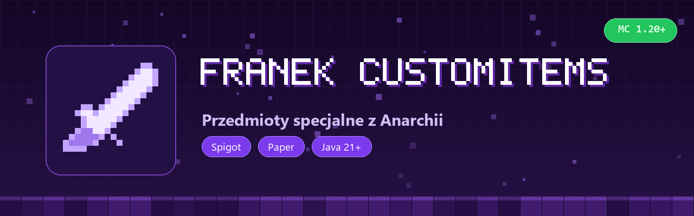

# FranekCustomItems



Custom itemy pod serwer Anarchia / BoxPvP (Excalibur z licznikiem killi, Boski Topor, Hydro Klatka, TurboDomek, TurboTrap, Wedka Nielota, Kosa, Korona, Plecaki, Sakiewki itd.).

Wszystkie itemy, ich nazwy, lore, cooldowny i efekty ustawia sie w configu. Wspolpracuje z WorldGuardem (blokada uzywania na spawnie) i WorldEditem (wklejanie schematow z `schematics/`).

## Komendy

| Komenda | Co robi |
|---|---|
| `/customitems [strona]` | otwiera GUI ze wszystkimi itemami |
| `/customitems reload` | przeladowuje config |
| `/customitems kills <ilosc>` | ustawia kille na trzymanym Excaliburze |

Permisja: `franek.customitems.command`.

## Config

`plugins/FranekCustomItems/pluginConfiguration.yml` oraz schematy (`turbodomek.schem`, `turbotrap.schem`) tworza sie same przy starcie:

```yaml
databaseType: SQLITE
regionsWhereItemsAreBlocked:
  - spawn
```

## Instalacja

Jar z folderu [`releases/`](releases/) wrzucasz do `plugins/` na serwerze (Spigot / Paper 1.20.x+) i restart.

## Budowanie

```bash
mvn package
```

Wychodzi `target/FranekCustomItems-1.0.jar`.

## Licencja

Wszelkie prawa zastrzezone. Autor: franekk ([GitHub](https://github.com/Blejziak)).
